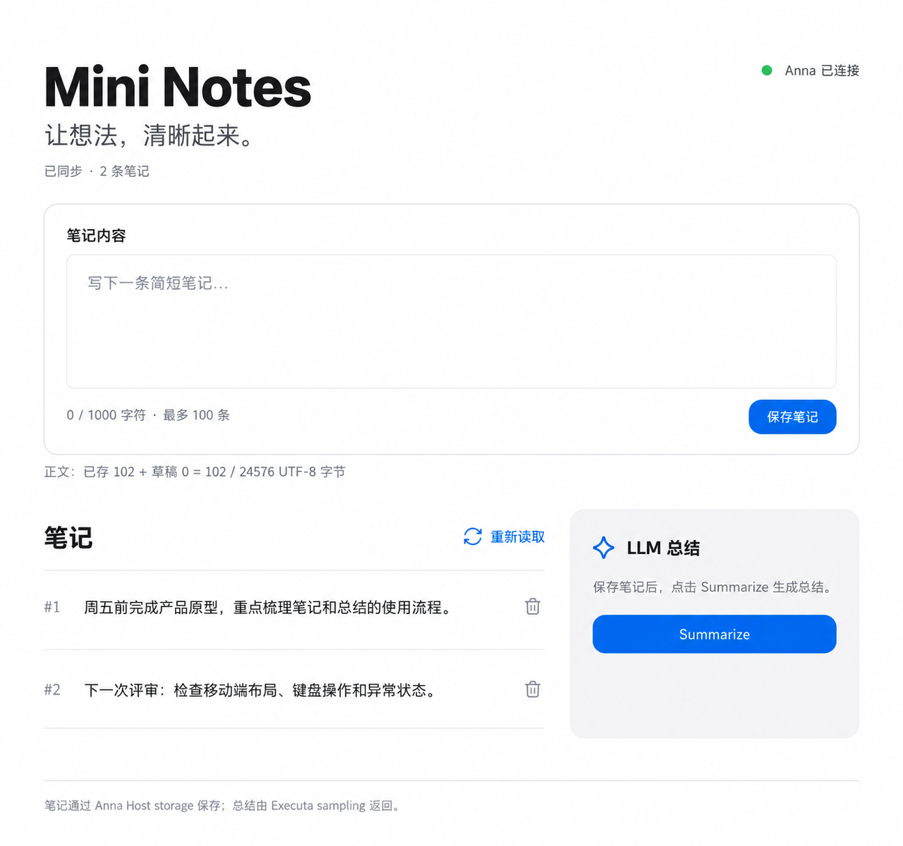

# Mini Notes 视觉改版设计

日期：2026-10-29

状态：用户已确认“按这张设计稿实施”，进入实现。

设计稿由内置 Image Gen 生成，原图为 1295 × 1214，对应约 960 × 900 的页面比例。图片仅用于设计审阅，生产界面使用真实 React 组件。生成简报为：完整 Mini Notes 工作台，Apple 风格的纯白画布、石墨文字、蓝色操作、输入区、开放笔记列表、浅灰总结面板及实际功能文案，不添加额外功能。

## 目标与方向

用户希望界面接近 Apple 官网的清晰、简洁和高级感。推荐浅色极简工作台，以纯白画布、石墨色文字、准确的字号层级、舒展留白和少量蓝色操作建立秩序。保留工具本身的直接性，打开页面即可记笔记。

另外两种可选方向是更紧凑的 macOS 工具风和对比更强的深色风。前者适合高密度使用，后者更强调视觉氛围；浅色方向更符合本次需求。

设计参考：[Apple 中国大陆官网](https://www.apple.com.cn/)。采用排版和视觉节制，不使用 Apple 标志或产品素材。

## 完整页面

1. 页头：`Mini Notes` 为唯一一级标题；右上角以小圆点和文字显示 Anna 连接状态。取消原来的 `ANNA APP` 装饰标签。
2. 简介：`让想法，清晰起来。`，下方小字显示真实同步状态和笔记数量。
3. 输入区：白色、细边框、圆角容器；保留 `笔记内容` 标签。输入框有轻微边线而无额外阴影，正文和占位文字有充足呼吸空间。
4. 输入区底部：字符数和条数上限位于左侧，蓝色胶囊形 `保存笔记` 位于右侧；UTF-8 容量行在容器外下方以小字持续可见。
5. 笔记区：开放式列表，保留添加序号和全文；列表行以细线分隔，不为每条笔记新增卡片。`重新读取` 为轻量蓝色文字操作。
6. 总结区：浅灰背景的独立面板，标题 `LLM 总结`，正文显示真实状态或 sampling 原文，提供 `Summarize` 按钮。
7. 页尾：保留 Anna Host storage 与 Executa sampling 的说明，以次要文字呈现。

设计图中的示例笔记仅用于说明排版。真实应用不预置或伪造用户笔记，也不显示伪造的总结。

## 视觉系统

| 项目 | 约定 |
| --- | --- |
| 页面背景 | 纯白 `#ffffff` |
| 主文字 | 石墨色 `#1d1d1f` |
| 次要文字 | 灰色 `#6e6e73`；必要的小字须保持可读对比度 |
| 总结面板 | 中性浅灰 `#f5f5f7` |
| 分隔线 / 边框 | `#e5e5e7` |
| 主操作 | 蓝色 `#0071e3`，白色文字 |
| 字体 | 系统字体栈：`-apple-system`、`BlinkMacSystemFont`、`Segoe UI`、`PingFang SC`、`Microsoft YaHei`、sans-serif；不加载远程字体 |
| 标题 | 宽屏约 56px，640px 窗口约 40px，360px 窗口约 34px；字重 600–700 |
| 小节标题 | 20–22px，字重 600 |
| 正文 / 输入 | 15–16px，行高约 1.65–1.8 |
| 标签 / 操作 | 13–14px；计数、容量和页尾为 11–12px |
| 容器 | 输入区与总结面板约 20px 圆角；笔记列表为开放区域 |
| 间距 | 以 4、8、12、16、24、32、40、48px 构成固定节奏 |
| 图标 | 少量细线 SVG：重新读取、删除、总结；线宽一致，使用 currentColor |
| 动效 | 约 160–200ms 的颜色、阴影和轻微显现变化；遵循 prefers-reduced-motion |

不增加背景插图、渐变、强阴影、装饰徽标或无关导航。生产 UI 由 React、CSS 与 SVG 图标构成，不将设计图作为页面背景或交互替代品。

## 布局与响应式

- 设计主屏参考尺寸为 960 × 900；内容最大宽度约 864px，左右留白约 48px，页头上方留白约 64px。
- 880px 及以上：输入区占满内容宽度，下方笔记区和总结区约按 5:3 分栏。左右区域顶部对齐。
- 880px 以下：输入区、笔记区、总结区依次单栏排列。原默认窗口 640 × 640 保留，允许纵向滚动。
- 360px：左右留白约 20px；按钮、计数和容量文字可换行；长连续内容、错误和总结不得撑出页面。
- 不设置导致内容被裁切的固定高度。大量笔记自然扩展页面，不能通过截断正文换取整齐。
- 保留 manifest 的最小窗口 360 × 360 和默认窗口 640 × 640。

## 功能与契约

仅调整 `MiniNotesApp`、`NotesList`、`SummaryPanel` 的呈现与样式；状态逻辑仍由现有 `useMiniNotes`、repository 和 summary service 管理。

以下要求保持：

- 空白不能保存，保存成功清空输入，保存中只读，保存失败保留草稿。
- 创建、读取和删除继续使用 Anna storage Host API，保留添加顺序与删除后的序号缺口。
- 总结继续通过 Anna tools.invoke → Executa → sampling/createMessage；不增加模型 API、HTTP 服务或本地规则总结。
- 保存、删除、重读、连接重试、Summarize 均保留；不加入编辑、搜索、标签或多笔记本。
- 笔记上限 100 条，单条 1000 Unicode 字符，正文累计 24576 UTF-8 字节。
- 保留连接中、读取中、写入中、写入待确认、失败、空列表、总结中、总结过期和截断状态。错误需要显示实际原因。
- `--no-llm` 下仍显示真实的 sampling 禁用错误。
- 总结过程中仍允许增删笔记；笔记变化后旧总结失效，迟到结果不得覆盖新状态。
- 用户内容按纯文本呈现，保留换行与长文本自动折行。

## 可访问性与自动化兼容

- 保留一级标题 `Mini Notes`，输入框名称 `笔记内容`。
- 保留按钮名称：`保存笔记`、`重新读取`、`Summarize`、`重试连接`。
- 删除按钮可使用图标，但保留 `aria-label="删除笔记 ${sequence}"` 和可发现的悬停提示；键盘和触屏均能操作。
- 保留 `note-${sequence}`、`composer-capacity`、`summary-text` 测试标识。
- 保留 `role="status"`、`role="alert"`、`aria-live="polite"` 和输入限制的 aria-describedby 关联。
- 不用颜色作为唯一状态标识；禁用和加载状态明确；焦点环清楚可见。
- 容量行继续展示真实的 `已存 … + 草稿 … = … / 24576 UTF-8 字节`，不折叠隐藏。

## 实施顺序与验收

1. 用户确认完整设计图和本设计文档（已完成）。
2. 建立 CSS 视觉变量，调整页头、输入区、列表与总结区的结构和图标。
3. 在现有 Anna harness 中逐屏比对设计图，验证 960px、640px 和 360px 布局以及键盘操作。
4. 运行既有前端测试、build、平台契约检查和严格 manifest 校验；在独立 harness 会话中验证创建、删除、重读及 Summarize 的实际 Host API 调用。
5. 对比设计与最终截图，记录字号、配色、布局、间距、按钮和响应式的差异并修正；保留原始 question.md 不变。

完成标准是界面与确认的设计一致，核心操作真实可用，原 Anna 平台契约及回归检查通过。历史 release 和后端协议不因本次视觉改版而重写。
